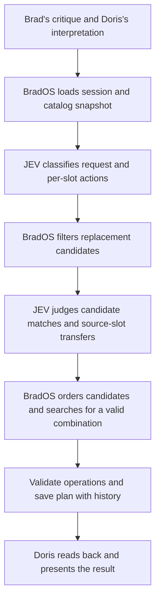
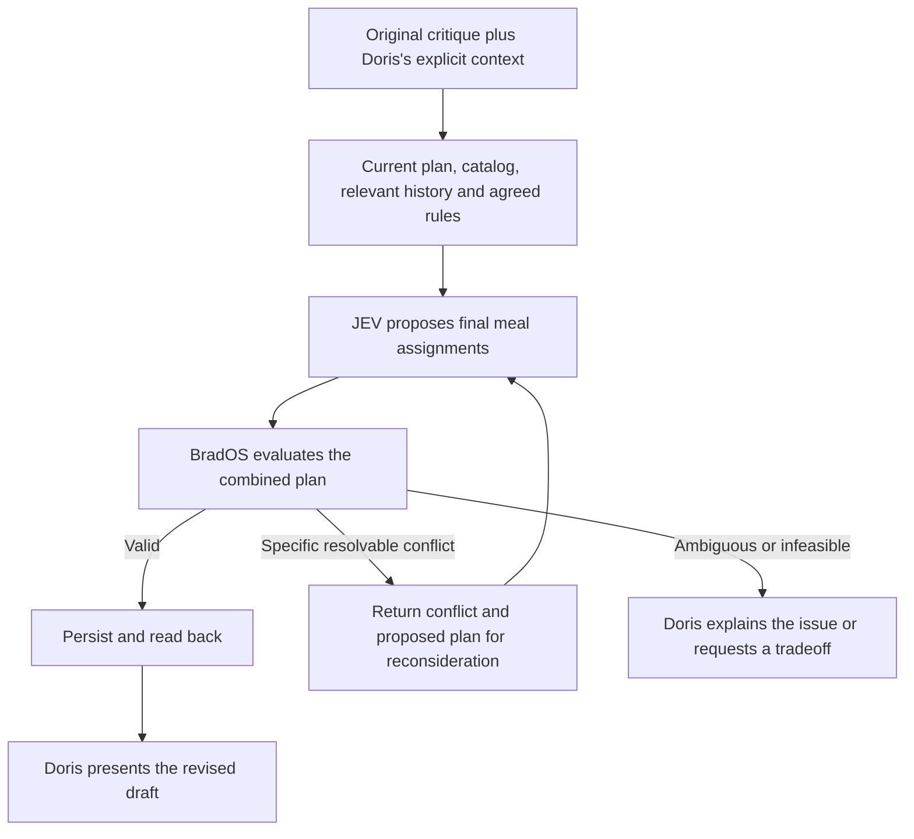

# JEV meal-plan revision: problem statement and proposed direction

Date: September 20, 2026
Status: Design recommendation for team review; not an implementation specification
Basis: The `mealplan-jev` working tree, including uncommitted investigation changes, reviewed on this date. This describes local branch behavior, not verified production behavior.

## Problem statement

Brad wants to critique a weekly meal plan in ordinary language and receive a coherent revised plan through Doris in Telegram. Requests can combine removals, replacements, swaps, calendar constraints, family preferences, and references to earlier feedback. The system should understand the intended final result, choose suitable catalog meals, preserve unrelated assignments, and clearly surface genuine ambiguity or unavailable options.

The current JEV integration decomposes this task into action classification and candidate acceptability judgments. BradOS then performs substantial meal selection itself. This produces a working bounded interface, but distributes the meaning of a critique across prompts, thresholds, filters, ordering rules, and special handling for transfers and follow-ups. A correct judgment in one stage can still produce no useful change because another stage rejects the request or removes all suitable candidates.

The proposed direction is to give JEV greater responsibility for choosing the revised meal assignments, with Doris supplying explicit intent and BradOS enforcing agreed rules and persisting the result. The product outcome is a complete next iteration of the plan. That does not require JEV to generate free-form plan JSON or require a particular number of API calls.

The objective is quality comparable to the former GPT-5.2 meal-planning workflow at materially lower measured inference cost. Neither quality parity nor the expected cost advantage has been established for the proposed design.

## Current system

### Responsibilities and data

- **Doris:** interprets conversation and calendar information, calls the BradOS meal-planning workflow, reads the saved plan back, and communicates with Brad. The repository's meal-planner instructions now emphasize explicit slot targets, rejection history, and preservation of unrelated meals. Those instructions alone do not prove consistent interpreter behavior.
- **Generation:** a separate constraint-based service creates the initial week without JEV. Current generated plans contain 28 slots: family breakfast, adult breakfast, family lunch, and family dinner for each day. Historical fixtures also include older family-only plans.
- **Session context:** the saved session contains the plan, a meal-catalog snapshot, creation time, and conversation history. Catalog evidence includes IDs, names, meal types, audiences, effort, prep-ahead status, red-meat status, and last-planned dates.
- **Critique and revision:** both use the same JEV critique service. Draft critique and finalized-plan revision remain separate routes; revision also reconciles meal recency.
- **Storage and operations:** BradOS represents changes as operations and validates their combined final state before persisting them. The operations service supports atomic exchanges, audience/type checks, duplicate checks, and prep-ahead limits, with allowances for some pre-existing exceptions. Additional rules, including red-meat checks, live in the critique service.

The backend currently accepts critique text. It does not receive dedicated Doris-interpretation or calendar-context fields. Calendar information used by this workflow must therefore be expressed in that text. Initial JEV intent questions receive a compact current plan and previous replacement targets; later candidate questions receive conversation history and candidate attributes. The full catalog is not supplied as one shared decision context.

### Current decision flow

Filtering includes meal type, audience, existing assignments, effort, prep-ahead capacity, and red-meat constraints. Candidate ordering prioritizes recency, then applicable effort preferences, then JEV match probability. Consequently, the model's strongest match does not necessarily become the selected meal.

The service uses fixed starting probability thresholds: 0.80 for decisions and candidate matches, and 0.95 for removals. An unresolved required decision can leave the entire plan unchanged. These thresholds are not demonstrated accuracy guarantees. The transport supports Choice and Noul questions, pins `jev-1.13.0` by default, validates responses, and applies retries and a deadline. Score questions and richer structured question descriptions from TypeSafe's documentation are not currently represented by the local schemas.

## Evidence and limits

The repository includes an opt-in evaluation suite using the real local HTTP API, a Firestore emulator, and real JEV calls. Fixtures contain retained historical conversations, catalog snapshots, and backfilled calendar information. Tests compare responses with saved-plan readback.

The recorded checkpoint reports 16 of 20 scenarios passing across two generation seeds. Failures included terse day references, a food rejection not confidently interpreted as replacement, a compound swap followed by removal, and failure to find a no-cook lunch. Subsequent prompt and test changes exist; the checkpoint must not be treated as a result for every current working-tree change.

The no-cook case illustrates an important distinction: catalog capacity and filtering can make a request infeasible independently of model understanding. Likewise, refusing an entire compound request does not prove the model misunderstood every component. Evaluation needs to distinguish interpretation errors, missing evidence, unavailable options, composition errors, and provider failures.

Historical GPT interactions also required corrections. They are evidence of the workflow and desired intent, not an infallible answer key. Backfilled calendars and mutable last-planned dates cannot establish everything known or eaten at the original planning time. Effort and prep-ahead fields are imperfect proxies for serving-time cooking requirements.

## Proposed direction

Explore a decision layer that takes the current plan plus a critique and proposes the next plan, including actual meal choices.

The reconsideration path should be bounded. The diagram describes responsibilities, not a required sequence of calls or internal data structures.

### Give JEV enough context to choose

Consider a shared context containing the original critique, Doris's interpretation, the current plan, catalog attributes, relevant rejections and preferences, planning dates, and calendar-derived requirements. Keep original statements distinguishable from inferred interpretations. Identify missing information instead of treating absent evidence as a fact.

Supplying the full catalog as context is a reasonable starting hypothesis. Restricting selectable options by exact type or audience can still be useful. The team should evaluate context coverage, request size, cost, and latency rather than assume either exhaustive context or aggressive filtering is always best.

### Let JEV select the result

A promising starting point is asking what each relevant slot should contain after the critique: its existing assignment, an empty slot, a particular catalog meal, or an unresolved outcome. This could remove the mandatory intermediate keep/replace/remove classification stage and the backend's current recency-first selection behavior.

For example, “We just had baked spaghetti; Tuesday needs something easy” should produce a suitable new Tuesday dinner while keeping the slot filled and preserving unrelated meals. Doris can explain what “easy” means that evening; JEV can choose the meal using catalog evidence and feedback. This is an illustrative intended behavior, not an observed result of the proposed approach.

TypeSafe's questions produce typed judgments rather than generated prose. Questions within one request run independently and cannot see one another's answers. A collection of slot choices therefore does not inherently solve whole-week coordination. Direct selection, comparable candidate scoring, sequential decisions, and targeted reconsideration are options for the team to compare—not prescribed implementation steps.

### Make rules and preferences explicit

Review existing restrictions before carrying them into the new decision layer. Distinguish structural validity, explicit user requirements, household policies, and flexible preferences. Recency, usual effort ranges, repetition, prep capacity, and red-meat limits need intentional treatment, including how an explicit critique interacts with them.

Do not silently relax a mandatory rule to make a request succeed. Conversely, do not reject a reasonable request because a historical preference has accidentally become an absolute filter. Preserve unrelated legacy exceptions unless the user requests broader replanning.

### Treat uncertainty according to its meaning

Uncertainty about which slot Brad means is different from several dinners being equally acceptable. A spread-out distribution across good meals should not automatically prevent an update. Removal, exact named selections, ambiguous references, and open-ended preferences may need different decision policies, evaluated against real examples.

Retain sufficient diagnostic evidence to explain outcomes: relevant input context, available choices, raw judgments, validation conflicts, correction attempts, and final saved state. Model confidence should not be presented as a probability that the entire workflow is correct.

## Proposed plan of action

| Phase | Recommended work | Outcome for review |
| --- | --- | --- |
| Establish the baseline | Reconcile the current code, test inventory, and recorded results. Label original, Doris-forwarded, and manually clarified requests separately. | A reproducible baseline and an honest failure taxonomy. |
| Agree on behavior | Review rules versus preferences, follow-up semantics, context ownership, and handling of unavailable meals. | A concise behavioral contract with representative examples. |
| Compare decision approaches | Evaluate direct final assignments and any justified alternatives against the existing pipeline. Keep model choices and deterministic constraints observable. | Evidence supporting an approach, including where it fails. |
| Exercise complete conversations | Replay multi-turn historical cases and held-out variations; verify both proposed and persisted plans. Test conflict handling and genuine infeasibility. | Quality, latency, and cost results for complete critique turns. |
| Integrate and assess rollout | Verify Doris's actual interpretation and readback behavior, both API routes, and user-visible outcomes before changing the live workflow. | A rollout recommendation with remaining limitations and a rollback path. |

The team's design decisions should follow the evidence; this proposal does not mandate new endpoints, a database migration, a scoring formula, a solver, or a fixed request count.

## Acceptance and evaluation criteria

- Correctly distinguish clearing a slot from rejecting its food, including “remove Monday” across all present tracks.
- Handle exact meal requests, exchanges, compound edits, family/adult distinctions, and repeated rejections without replaying completed edits.
- Select plausible replacements consistent with the request and evidence; do not demand one predetermined meal when several are acceptable.
- Preserve unrelated slots and evaluate edits together, including transfers and shared weekly constraints.
- Clearly distinguish success, no change requested, ambiguity, infeasibility, validation failure, and service failure. An HTTP success response alone is insufficient evidence of an applied critique.
- Verify persisted state and conversation history, plus finalized-plan recency behavior where relevant.
- Keep approval for finalization and shopping-list actions separate from critique interpretation.
- Measure actual token usage, cost, end-to-end latency, correction rate, and clarification rate. Include Doris's contribution when comparing total workflow cost.
- Report repeated and held-out results, with model version and fixture provenance. Agree on quality and cost targets before a rollout decision; do not infer parity from unit tests or aggregate pass counts alone.

Initial generation, recipe invention, ingredient-level guarantees, and Telegram transport changes are outside the central redesign. They may expose dependencies, but should not silently expand its scope.

## Code and documentation references

Paths below are repository-relative so this handoff remains usable in another checkout.

| Area | Current reference |
| --- | --- |
| Critique decisions and candidate selection | `packages/functions/src/services/mealplan-critique.service.ts` |
| JEV transport and local supported primitives | `packages/functions/src/services/mealplan-jev.service.ts`; `packages/functions/src/schemas/mealplan-jev.schema.ts` |
| Atomic operation validation | `packages/functions/src/services/mealplan-operations.service.ts` |
| Critique/revision routes and persistence orchestration | `packages/functions/src/handlers/mealplans.ts` |
| Initial generation | `packages/functions/src/services/mealplan-generation.service.ts` |
| Meal and session context | `packages/functions/src/types/meal.ts`; `packages/functions/src/types/mealplan.ts` |
| Live evaluation and evidence caveats | `packages/functions/src/__tests__/live/mealplan-jev.live.test.ts`; adjacent `README.md` and `RESULTS.md` |
| Doris workflow instructions | `.agents/skills/meal-planner/SKILL.md` |
| Architecture overview | `docs/architecture/meal-planning.md` |
| Installed TypeSafe guidance | `.agents/skills/typesafe-ai/SKILL.md` |

The TypeSafe guidance supporting this proposal is its [building guide](https://docs.typesafe.ai/concepts/how-to-build-with-system-one), [parallel-question pattern](https://docs.typesafe.ai/patterns/fan-out), [Choice primitive](https://docs.typesafe.ai/primitives/choice), [Score primitive](https://docs.typesafe.ai/primitives/score), and [function-calling example](https://docs.typesafe.ai/cookbooks/function_calling). These describe available patterns, not evidence of meal-planning quality.
